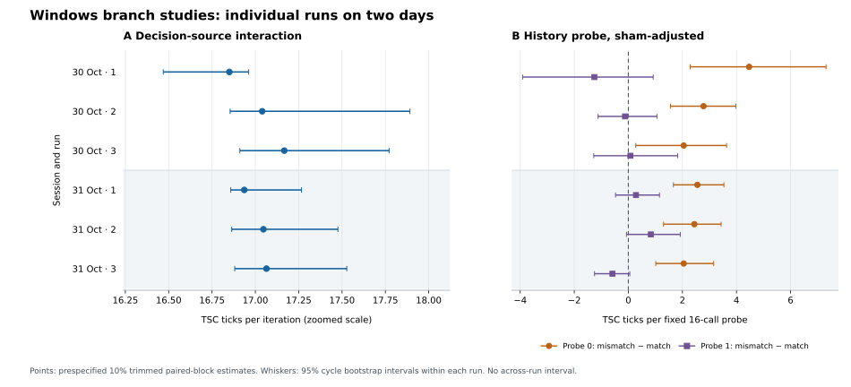

# Native x86 conditional-branch timing studies

**Research record through 31 October 2026.** This report consolidates the frozen protocols, physical-host pilot, and two-day replication of two independent Windows user-mode experiments. It is a report of observed timing behavior on one AMD Ryzen 7 9800X3D host, not a claim of a new branch-predictor mechanism or a reproduction of a cross-privilege result.

## Abstract

[Ravichandran and Yan's Fractal work](https://people.csail.mit.edu/mengjia/data/2026.SP.fractal.pdf) uses controlled microarchitectural tests to investigate branch predictors, including privilege-domain experiments on Apple M1. This repository develops separate, native x86 tests runnable from VS Code on a Windows workstation. Study A asks whether batch timing at one conditional branch depends on the **order of the branch's actual decisions**, rather than merely on an unchanged live input stream. Study B asks whether an earlier all-zero or all-one training phase changes the latency of a fixed short probe, after adjustment for a branchless sham trainer. Their endpoints are TSC timing in one user-mode process.

One pilot per study was followed by six complete runs per study on 30 and 31 October, three per day. Study A's six primary contrasts range from **+16.850 to +17.167 TSC ticks per iteration**. Its three predeclared practical negative-control intervals and added-work timer control pass in every run. Study B has a positive sham-adjusted probe-0 contrast in all six runs, **+2.048 to +4.468 ticks per fixed 16-call probe**; probe 1 has mixed signs and all six of its within-run intervals include zero. This is a reproducible one-sided timing association under Study B's protocol, without the anticipated bidirectional pattern. The data do not count mispredictions, identify a predictor circuit, test a privilege boundary, or show speculative leakage.

## Scope, attribution, and research question

Fractal is the operating system developed by Joseph Ravichandran and Mengjia Yan. Their paper describes a progression from a working single-threaded microarchitecture test to sender/receiver experiments and then privilege-domain comparisons; its evaluation studies Apple M1 conditional and indirect branch predictors. The [pinned upstream revision](UPSTREAM_FRACTAL_REVISION) and [study-plan discussion](WINDOWS_BRANCH_STUDIES.md) document that connection. The Windows programs, analyzers, controls, and measurements in this repository are independent project work. They run on the host OS and do not boot Fractal. Their contribution is a controlled **local x86 timing characterization**, not the authors' operating system, M1 findings, or cross-domain experiment.

The immediate questions were:

1. If the bytes read and returned by a timed loop remain the same, does changing which stream controls a fixed conditional jump produce a timing interaction beyond the fixed-stream and branchless controls?
2. After matched or mismatched training at a fixed branch site, does a fixed probe show a corresponding latency difference beyond a sham-training contrast, separately for probe outcomes 0 and 1?

These questions concern associations under specified instruction sequences. A positive timing contrast alone does not prove why the processor took longer.

## Protocol chronology and analysis status

| Stage | Record | Status of choices |
| --- | --- | --- |
| Study design | [Two-study plan](WINDOWS_BRANCH_STUDIES.md), introduced in `c1f5299` | A's primary interaction, ±0.5 tick/iteration practical negative-control tolerance, timer gate, B's two separate sham-adjusted outcomes, 10% trim and complete-cycle bootstrap were written before physical A/B data. |
| Build correction | `84f6182` | Distinct filenames for MASM and C object files fixed linker failures before successful physical A/B pilots. No pilot measurements came from those failed builds. |
| Physical pilots | [Pilot archive](results/2026-10-30-windows-followup-pilots/README.md), A `2026-10-30T16:37:09Z`, B `16:37:24Z` | One measurement session. This established trace validity, controls, executable pairing, instruction layout, and approximate sensitivity. The pilots are reported separately, not added to the planned replication counts. |
| Replication | [Two-day archive](results/2026-10-30-31-windows-followup-replication/README.md), three runs per study on each date | The A/B measurement source and frozen estimands were unchanged. Day 1 ran A then B; day 2 ran B then A. With one day per order, day and order effects cannot be separated. |

The pre-pilot B plan specified two separate directional comparisons, but **no formal numerical pass/fail gate requiring both to be positive**. The added-work timer was its formal control gate. The 20% trimmed summaries, probe-length proposals, and this synthesis are post-data work. They must not replace the frozen 10% primary analyses. The archive reports all supplied runs, including the first pilot; the files alone cannot prove that no other runs were attempted elsewhere.

## Host and measurement methods

The three archived Windows snapshots record an AMD Ryzen 7 9800X3D (8 cores, 16 logical processors), Gigabyte X870E AORUS ELITE WIFI7, BIOS FA9, Windows 11 Pro build 26200, Balanced power plan, and `HypervisorPresent=True`. The traces report `AuthenticAMD`, signature `0x00b40f40`, invariant TSC, hypervisor presence, and affinity to logical CPU 0. The observed GCD of measured totals is 47 TSC ticks in the pilot and two-day runs. Its physical cause is unknown. Exact microcode, mitigation state, thermal or frequency behavior, competing workload, and SMT-sibling activity were not captured.

Study A times 8,192 calls per condition in each of 144 randomized complete eight-condition blocks after warm-up. A fixed branch instruction can follow the live input or a fixed `0011` decision stream selected by a runtime mode, while both modes still read the live input and return the same live value. Each live stream is either repeated `0011` or a fresh balanced shuffle; both have equal zero/one counts. The primary **paired blockwise** contrast, divided by 8,192 before reporting in ticks/iteration, is:

```text
[(live shuffled - live periodic) - (fixed shuffled - fixed periodic)] / 8192
```

Its three practical negative controls are fixed-source shuffled minus periodic, branchless shuffled minus periodic, and live minus fixed under periodic input. To pass, the *entire* within-run interval for each must be inside ±0.5 tick/iteration. A fast/slow added-work timer comparison must be positive in at least 95% of blocks and have a positive interval lower bound. A positive primary contrast was **not** an acceptance gate.

Study B uses a common 256-call balanced prelude at the conditional site, then 256 all-zero or all-one training calls at the conditional site or a separate branchless sham site, then a fixed 16-call probe at the conditional site. The prelude standardizes prior activity; it has not been shown to reset predictor state. Each condition sums 128 episodes, and each run has 320 randomized complete ten-condition blocks after warm-up. For probe 0, training 1 is the mismatch; for probe 1, training 0 is the mismatch. Each prespecified outcome subtracts the sham mismatch-minus-match contrast from the corresponding real-training contrast **within each block**, reported in ticks per fixed 16-call probe. The separate slow timer wrapper adds an unconditional `PAUSE` during the timed probe. Its passing gate demonstrates sensitivity to that added work, roughly 54 to 57 ticks per probe in the replication, not guaranteed sensitivity to effects around 1 to 4 ticks.

Both frozen analyzers check the seed-derived schedules, sample counts, checksums, metadata, and control records. The point estimator is a 10% trimmed mean of paired blockwise differences. The 95% bootstrap intervals resample complete eight-block cycles for A or ten-block cycles for B **within a run**. They are not intervals over independent runs, days, machines, or populations. The two studies have different units and are not pooled.

## Evidence integrity and instruction audit

The [pilot manifest](results/2026-10-30-windows-followup-pilots/manifest.json) records byte sizes and SHA-256 for its five supplied originals. The [replication ledger](results/2026-10-30-31-windows-followup-replication/original-file-sha256.json) does the same for its 26 originals and records the supplied archive hash. All 12 replication traces passed strict replay validation, and every archived EXE SHA-256 matches its paired trace. The six A executables have the same executable `.text` SHA-256 as the audited A pilot, `0f302df7d38b2c1e1eb840104cd4c51da4d0d802a8e540ee74fd8d20a11ec1e9`; the six B executables match the B pilot `.text` hash, `b7ee4707628ac45f621ffd281066efd0cff3652717324fe3baa7c592c8289e3b`. The [series summary](results/2026-10-30-31-windows-followup-replication/series-summary.json) retains each full EXE hash and run estimate.

Disassembly of the physical pilot binaries located A's actual conditional jump at PE RVA `0x1c05` and B's at `0x1c85`, with one direct in-loop call to each respective branch-site function for the primary conditions. A selects its decision byte with `cmovne`; its separate branchless control uses `setne`. B's common in-loop conditional-site call serves prelude, real training, and probe; the primary timed wrapper contains no added-work branch. The sham training site and outer caller sites differ, a genuine limitation. The [instruction audit appendix](results/2026-10-30-windows-followup-pilots/INSTRUCTION_AUDIT.md) records exact bytes, PE address mapping and reproducible read-only commands. Identical `.text` across the 12 replication binaries preserves the audited instruction sequences, although the exact source revision cannot be proved from a trace or executable alone. The scripts document their MSVC build commands; exact historical compiler and linker versions were not captured.

## Results: Study A

The pilot primary interaction was **+17.083** ticks/iteration, with within-run interval **[+16.874, +17.771]**. Its fixed-source, branchless, and periodic-mode negative-control intervals fit the predeclared ±0.5 margin, and the timer gate passed. It is one pilot, not a third replication session.

| Replication date, UTC start | Seed | Primary ticks/iteration | Within-run 95% interval |
| --- | ---: | ---: | ---: |
| 30 Oct, 17:46:45 | 3307609659 | +16.850 | [+16.469, +16.962] |
| 30 Oct, 17:46:55 | 1830731156 | +17.040 | [+16.854, +17.892] |
| 30 Oct, 17:47:04 | 2051132703 | +17.167 | [+16.910, +17.772] |
| 31 Oct, 18:00:20 | 476165243 | +16.936 | [+16.858, +17.266] |
| 31 Oct, 18:00:38 | 1308128947 | +17.047 | [+16.863, +17.476] |
| 31 Oct, 18:00:47 | 1015215205 | +17.064 | [+16.881, +17.528] |

All 18 full negative-control intervals, three per replication run, fit inside ±0.5 tick/iteration; the largest absolute endpoint is 0.175. All six added-work timer gates pass, with 139/144 to 142/144 positive blocks. The primary run estimates span +16.850 to +17.167; the descriptive means of the three run estimates on each day are +17.019 and +17.016. An exploratory 20% trim spans +16.843 to +16.942. All raw blocks are retained. The positive direction recurs with distinct seeds and on two calendar days on this host, but the precise uncertainty across days cannot be inferred from within-run intervals or only two days.

## Results: Study B

The pilot sham-adjusted outcomes were **+0.919 [−0.242, +2.021]** for probe 0 and **−0.480 [−1.211, +0.374]** for probe 1, in ticks per fixed 16-call probe. Both intervals included zero. The added-work timer gate passed. The unadjusted pilot probe-0 contrast had a positive interval, but the prespecified sham-adjusted comparison is the appropriate primary result.

| Replication date, UTC start | Seed | Adjusted probe 0, within-run 95% interval | Adjusted probe 1, within-run 95% interval |
| --- | ---: | ---: | ---: |
| 30 Oct, 17:47:49 | 1753270348 | +4.468 [+2.288, +7.314] | −1.256 [−3.910, +0.919] |
| 30 Oct, 17:48:02 | 1668170065 | +2.781 [+1.558, +3.977] | −0.123 [−1.120, +1.057] |
| 30 Oct, 17:48:11 | 3138604200 | +2.048 [+0.274, +3.635] | +0.075 [−1.279, +1.824] |
| 31 Oct, 17:58:36 | 675337818 | +2.555 [+1.667, +3.534] | +0.283 [−0.473, +1.152] |
| 31 Oct, 17:58:45 | 2397628812 | +2.441 [+1.301, +3.431] | +0.832 [−0.069, +1.921] |
| 31 Oct, 17:58:54 | 2914531768 | +2.048 [+1.014, +3.157] | −0.590 [−1.251, +0.053] |

All six timer gates pass, with 310/320 to 318/320 positive blocks. Adjusted probe 0 is positive in all six replication runs and each within-run interval lies above zero. Its descriptive day means are +3.099 and +2.348 ticks/probe. Probe 1 has three positive and three negative estimates; every interval includes zero, and its day means are −0.435 and +0.175. The one-sided probe-0 pattern warrants investigation, but **does not demonstrate the anticipated bidirectional crossover**. The first replication run's +4.468 probe-0 estimate coincides with a −1.209 sham-only contrast; a paired, trimmed difference must not be reconstructed by subtracting separately trimmed columns. Exploratory 20% trims retain positive probe-0 estimates, +1.979 to +3.012, and mixed probe-1 estimates, −0.501 to +0.457. These exploratory checks do not revise the primary estimator.



The figure's A axis is zoomed; its whiskers are within-run intervals. The [figure source](results/2026-10-30-31-windows-followup-replication/plot_followup.py) regenerates it from the raw traces.

## Claim ledger and limitations

| Claim | Evidence and status |
| --- | --- |
| A branch-decision-order timing interaction occurs in this executable on this host | Supported descriptively by six distinct-seed runs on two dates, stable audited `.text`, and passing predeclared negative and timer controls. |
| B's probe-0 sham-adjusted latency association recurs under this protocol | Supported descriptively in all six replication runs, with within-run intervals above zero. Sham training uses a different code site, and day-level generalization is limited. |
| B demonstrates the intended two-direction history crossover | **Not established.** Probe 1 changes sign and all six within-run intervals include zero; no formal two-direction numerical gate was prespecified. |
| These timings identify branch-predictor misses or their per-miss cost | **Not established.** There is no validated hardware event count, and instruction execution, global history, return path, cache, power, and timing effects remain possible. |
| These runs reproduce Fractal's privilege-boundary or Apple M1 findings | **Not tested.** All new measurements were in one Windows user-mode process on x86. |

The current endpoints are aggregate TSC latencies. B's 16-call probe can change the state it attempts to sample, and the sham trainer occupies a different address. Its timer control detects much larger added work than the observed few-tick probe-0 contrast. A's controls narrow input-processing explanations, but do not uniquely assign the contrast to one predictor structure. Every run came from one machine, with only two replication dates and no controlled assessment of day-versus-study-order effects. Results should be presented as **same-host measurements**, not as a general property of Ryzen 7 9800X3D processors or an exploitable security boundary.

## Reproduction and next falsification tests

From the repository root, Python 3 can recompute the full two-day summary; Matplotlib is needed only for the figure:

```bash
python3 scripts/summarize_followup_series.py results/2026-10-30-31-windows-followup-replication/manifest.json --output results/2026-10-30-31-windows-followup-replication/series-summary.json
python3 results/2026-10-30-31-windows-followup-replication/plot_followup.py
python3 -m unittest discover -s tests
```

For one run, use `scripts/analyze_decision_source.py` or `scripts/analyze_history_probe.py` with its archived `.log`, `--strict --json`. The [replication report](results/2026-10-30-31-windows-followup-replication/README.md) and [original-file ledger](results/2026-10-30-31-windows-followup-replication/original-file-sha256.json) provide the exact inputs. The series script checks host/trace/EXE pairing, unique seeds, original control verdicts, stable code sections, and all listed runs. Tests of the analyzer and series logic ran in a development environment; physical Windows execution is evidenced by the supplied traces and binaries, not by those tests.

The [separate B2 design proposal](EXPLORATORY_HISTORY_B2.md) specifies a first exploratory comparison of one-call and sixteen-call probes, with a same-site fixed-decision trainer and a timer control closer to the observed scale. It preserves both probe outcomes and calls for a new pilot before selecting one primary comparison for a later confirmatory series. No B2 code or physical measurement exists yet. For A, a separately validated hardware-event measurement could help distinguish predictor activity from other timing causes if counters can be used reliably on this host. None of these future tests changes the archived protocols or conclusions above.
