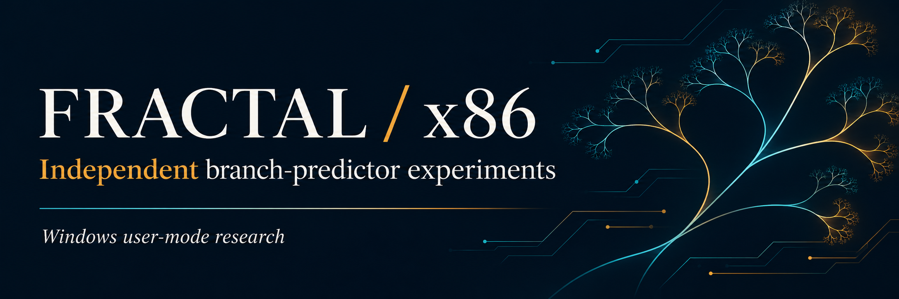
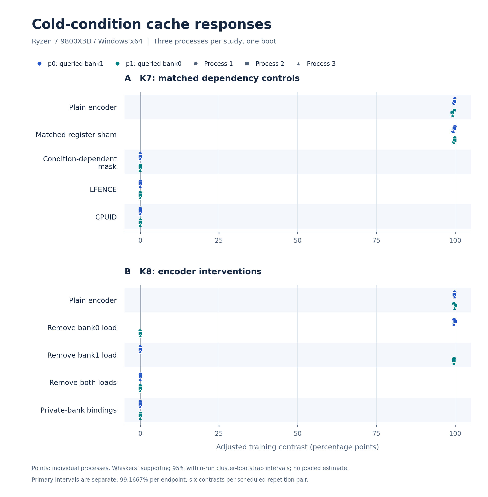
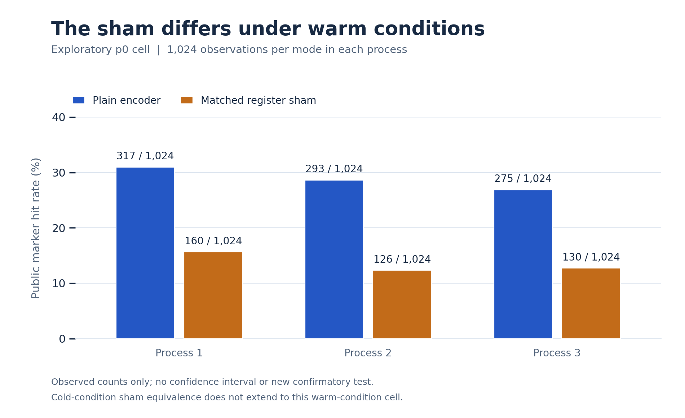

<p align="center">
  
</p>

<p align="center">
  <a href="../../README.md#reproduce"></a>
  <a href="../../LICENSE"></a>
</p>

<p align="center">
  <a href="../../README.md">English</a> · <a href="README.pl.md">Polski</a> · <a href="README.de.md">Deutsch</a> · <a href="README.fr.md">Français</a> · <a href="README.es.md">Español</a> · <a href="README.pt-BR.md">Português (Brasil)</a><br>
  <a href="README.zh-CN.md">简体中文</a> · <a href="README.ja.md">日本語</a> · <a href="README.ko.md">한국어</a> · <strong>Русский</strong> · <a href="README.ar.md">العربية</a> · <a href="README.nl.md">Nederlands</a>
</p>

# Fractal x86

Эксперименты с предсказанием ветвлений и кэшем на **AMD Ryzen 7 9800X3D под
Windows x64**, основанные на подходе из работы
[Fractal](https://people.csail.mit.edu/mengjia/data/2026.SP.fractal.pdf)
Джозефа Равичандрана и Мэнцзя Янь. Исследовательская документация включает
заранее заданные протоколы, исходные трассы, согласованные контрольные условия,
хеши исполняемых файлов и анализы, которые можно повторить.

В исследованиях под Windows измеряется воспроизводимая реакция кэша,
зависящая от обучения. Контроли с зависимостью данных и вмешательства в
кодирование позволяют проверить, какие изменения подавляют эту реакцию.

[Исследовательский отчёт](../../RESEARCH_REPORT.md) · [Результаты и данные](../../results/k7-k8-windows-causal/README.md) · [Руководство по воспроизведению](../../results/k7-k8-windows-causal/REPRODUCE.md) · [Следующие исследования](../../RESEARCH_ROUTE.md)

## Результаты

| Исследование | Репликация | Результат | Документация |
|---|---|---|---|
| K3: новый приёмник | Один процесс | Результат неубедителен: 56/58 контрольных критериев; отрицательные контроли не пройдены | [K3](../../results/k3-fresh-windows/README.md) |
| K4: контроль контекста | Пилотный и три последующих процесса | По 58/58 контрольных критериев; реакция воспроизводится | [K4](../../results/k4-context-windows/README.md) |
| K5: контроль зависимости | Три загрузки Windows | 1,179,648 эпизодов; 88/88 контрольных критериев в каждой попытке | [K5](../../results/k5-windows-replication/README.md) |
| K7: согласованная зависимость | Три новых процесса в рамках одной загрузки | По 140/140 контрольных критериев; первичные критерии при холодном условии выполнены | [K7/K8](../../results/k7-k8-windows-causal/README.md) |
| K8: вмешательства в кодирование | Три новых процесса в рамках той же загрузки | По 140/140 контрольных критериев; критерии вмешательства в публичную реакцию выполнены | [K7/K8](../../results/k7-k8-windows-causal/README.md) |
| K6: проверка привилегий | Функциональный программный тест в QEMU TCG | Проверки CPL/PC пройдены; сбор данных на физическом оборудовании ещё не выполнен | [K6](../../results/k5-k6-development/README.md) |

K7/K8 содержат **983,040 эпизодов**, в том числе 491,520 эпизодов отложенной
выборки. Репликация оценивается между процессами; эпизоды внутри процесса
относятся к одним и тем же условиям запуска.

## Влияние зависимости и кодирования

Для первичного показателя p0 при холодном условии разность «фиктивная маска
минус истинная маска» составляет +99.902, +99.707 и +99.414 процентного пункта
в трёх повторениях. Интервалы разности plain минус sham находятся в пределах
заранее заданной границы эквивалентности +/-10 pp. Удаление загрузки кодировщика
для запрашиваемого банка или перенаправление обеих загрузок подавляет публичную
реакцию. Если удалить только загрузку для другого банка, реакция сохраняется.



*Точки обозначают оценки по процессам, а усы показывают вспомогательные 95%
интервалы кластерного бутстрэпа внутри одного запуска.
Для [18 первичных контрастных интервалов](../../results/k7-k8-windows-causal/endpoint-table.csv)
используется зафиксированное правило Бонферрони: приблизительно 99.17% на
каждый показатель. Каждое семейство из шести контрастов охватывает одну
запланированную пару повторений. Скорректированные контрасты могут превышать
100 pp.*

В поисковом контроле p0 при тёплом условии фиктивная маска снижает долю
попаданий на 14.16–16.31 pp. Поэтому результат об эквивалентности при холодном
условии относится именно к этому первичному показателю.

<details>
<summary>Контроль при тёплом условии</summary>



Описательные подсчёты для вспомогательного тёплого условия, вне шести первичных
контрастов.

</details>

## Воспроизведение

Используйте Python 3.10+ и его стандартную библиотеку, чтобы повторно проверить
по исходному архиву пороги, подсчёты по ячейкам, контрольные критерии и первичные
точечные оценки:

```sh
python results/k7-k8-windows-causal/independent-counts/audit_counts.py results/k7-k8-windows-causal/inputs/causal-windows-evidence-20261108T173801487095Z-6d4bcf3a.zip --output out/k7-k8-count-recheck
```

[Руководство по воспроизведению](../../results/k7-k8-windows-causal/REPRODUCE.md)
описывает точное повторение анализа, построение графиков и проверку кода.
Каждый результат сопровождается исходными архивами и хешами.
[Проверка программного обеспечения](https://github.com/xShadyy/fractal-x86-branch-predictor/actions/workflows/validation.yml)
охватывает тестовые данные анализа, сгенерированный код и документацию.

Завершённые исследования сохраняют зафиксированные планы и версии исходного
кода. Новый сбор данных начинается с нового плана. Для сбора данных под Windows
нужны MSVC x64 Build Tools и Windows SDK.

## Повторный анализ данных авторов Fractal

[Повторный анализ артефакта M1](../../results/fractal-author-data-reanalysis/README.md)
проверяет **48 трасс и 240,192 опубликованные строки** из измерений,
предоставленных Равичандраном и Янь. JSON, CSV и рисунки доступны вместе с
документацией о происхождении артефакта и его лицензировании.

## Контекст измерений

Измерительные программы Windows работают в пользовательском режиме.
K5 охватывает три загрузки одной рабочей станции. K7/K8 используют по три
процесса на исследование в рамках одной загрузки; наличие гипервизора и VBS
задокументировано. Вмешательства действуют как во время обучения, так и во
время зондирования; контроль с приватным банком наблюдает публичную реакцию.

Времена датчиков K7/K8 кратны 47 отсчётам TSC и позволяют выполнять
калиброванную классификацию кэш-состояний. Точный предсказатель, путь
транзиентного выполнения и физическое влияние из пользовательского режима на
режим ядра остаются открытыми вопросами.
[Следующие исследования](../../RESEARCH_ROUTE.md) описывают варианты сбора
данных при прямом запуске Linux и Fractal на оборудовании.

## Файлы проекта

| Путь | Содержимое |
|---|---|
| [`programs/`](../../programs/) | Измерительные программы на C и измерительные участки ассемблерного кода |
| [`protocols/`](../../protocols/) | Планы сбора данных и правила анализа |
| [`scripts/`](../../scripts/) | Инструменты сбора, анализа и проверки происхождения данных |
| [`tests/`](../../tests/) | Программные тестовые данные и регрессионные проверки |
| [`results/`](../../results/) | Исходные материалы измерений, числовые таблицы и рисунки |

## Цитирование

Проект поддерживает [Tymoteusz Netter](https://github.com/xShadyy).
Для цитирования этого программного обеспечения используйте
[CITATION.cff](../../CITATION.cff).

> Joseph Ravichandran и Mengjia Yan. *Fractal: An Operating System Designed
> for Microarchitecture Reverse Engineering*. IEEE Symposium on Security and
> Privacy, 2026. [Статья](https://people.csail.mit.edu/mengjia/data/2026.SP.fractal.pdf)
> · [Fractal OS](https://github.com/jprx/fractal)
> · [Исследовательский артефакт](https://doi.org/10.5281/zenodo.19556693)

Код проекта распространяется по [лицензии MIT](../../LICENSE). Компоненты
исходного проекта и артефакт авторов сохраняют собственные лицензии и указание
авторства.
