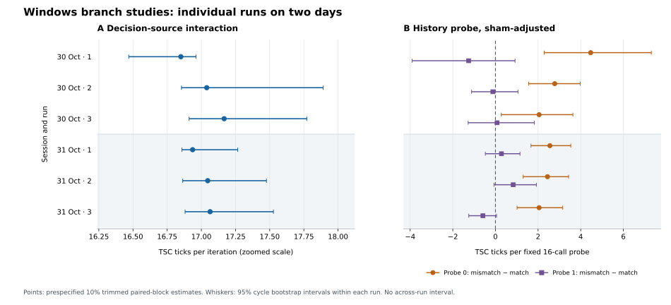

# Two-day Windows follow-up replication

**Status:** Six complete decision-source runs and six complete branch-history runs were supplied from two sessions on different calendar days, three per study per day. The frozen trace analyzers validate every run, all archived EXE hashes match their paired traces, and the compiled code sections match the [audited pilots](../2026-10-30-windows-followup-pilots/README.md). Study A repeats its large decision-order timing interaction with all predeclared controls passing. Study B repeats a positive sham-adjusted effect for probe 0, but does not show the anticipated bidirectional pattern because probe 1 remains mixed and imprecise.

## Evidence and design

The [manifest](manifest.json) identifies exactly the 12 trace/EXE pairs and two host snapshots. The [original-file ledger](original-file-sha256.json) records SHA-256 and byte size for each of the 26 files copied byte for byte from the supplied `Days.zip`, plus that archive's SHA-256. The [machine-readable summary](series-summary.json) holds all individual estimates, within-run intervals, controls, binary hashes, code hashes and descriptive day summaries. The archive contained these 12 runs; its contents cannot establish that no other runs took place.

Session 1 began with a snapshot at `2026-10-30T17:46:29Z`, followed by three A runs and three B runs. Session 2 began with a snapshot at `2026-10-31T17:58:21Z`, followed by three B runs and three A runs. The number of runs and distinct dates satisfy the [pre-pilot follow-up plan](../../WINDOWS_BRANCH_STUDIES.md). The order is counterbalanced across days, though day and order cannot be separated with only two sessions. The earlier A/B pilots on 30 October are not included as planned replication runs. All 12 seeds are distinct and nonzero.

Both snapshots record Windows 11 Pro build 26200, AMD Ryzen 7 9800X3D (8 cores, 16 logical processors), Gigabyte X870E AORUS ELITE WIFI7, BIOS FA9, the Balanced power plan and a present hypervisor. The traces report CPU signature `0x00b40f40`, invariant TSC, hypervisor presence and affinity to logical CPU 0. All 12 measured-total GCDs equal 47 TSC ticks; this observation does not identify the cause. Exact microcode, mitigation settings, temperature, clock behavior and concurrent work were not captured.

For each study, the six `.text` SHA-256 hashes are identical to its audited pilot: A `0f302df7d38b2c1e1eb840104cd4c51da4d0d802a8e540ee74fd8d20a11ec1e9`, B `b7ee4707628ac45f621ffd281066efd0cff3652717324fe3baa7c592c8289e3b`. Full EXE hashes differ across builds and each matches its trace. The site entries remain at the same offsets after accounting for ASLR. In the pilots, disassembly located A's conditional jump at RVA `0x1c05` and B's at `0x1c85`; unchanged `.text` binds these runs to the same audited instruction sequences. The documented build workflow associates the binaries with repository revision `84f6182`; a trace or PE image alone cannot prove its source revision.

All intervals below are the frozen analyzers' 95% bootstrap intervals obtained by resampling complete condition-position cycles **within one run**. Run estimates use the predeclared 10% trimmed mean of paired blockwise contrasts. Day means are descriptive means of three run estimates, without an across-day confidence interval. The two studies have different units and are never pooled.



The [plot source](plot_followup.py) regenerates the figure from the raw traces. Its A axis is zoomed and labeled; the whiskers measure within-run uncertainty only.

## Study A: decision-source interaction

The same conditional branch follows a live periodic or freshly balanced shuffled input stream, or a fixed `0011` decision stream while still reading the live input. The primary interaction is `[(live shuffled − live periodic) − (fixed shuffled − fixed periodic)] / 8192`, paired within each of 144 randomized eight-condition blocks per run. Values below are TSC ticks **per branch-loop iteration**.

| Day, UTC start | Seed | Primary interaction | Within-run 95% interval | Timer-positive blocks |
| --- | ---: | ---: | ---: | ---: |
| 30 Oct, 17:46:45 | 3307609659 | +16.850 | [+16.469, +16.962] | 142/144 |
| 30 Oct, 17:46:55 | 1830731156 | +17.040 | [+16.854, +17.892] | 142/144 |
| 30 Oct, 17:47:04 | 2051132703 | +17.167 | [+16.911, +17.772] | 140/144 |
| 31 Oct, 18:00:20 | 476165243 | +16.936 | [+16.858, +17.266] | 142/144 |
| 31 Oct, 18:00:38 | 1308128947 | +17.047 | [+16.864, +17.477] | 139/144 |
| 31 Oct, 18:00:47 | 1015215205 | +17.064 | [+16.881, +17.528] | 139/144 |

All 18 entire negative-control intervals, three per run, fit inside the prespecified ±0.5 tick/iteration tolerance. The largest absolute interval endpoint is 0.175. Every added-work timer control passes the ≥95% positive-block and positive lower-bound gates. The primary estimates span +16.850 to +17.167; the 30 and 31 October means are +17.019 and +17.016. An exploratory 20% trim gives +16.843 to +16.942 across the six runs. All raw blocks were preserved; none was removed after inspection.

The repeated outcome-order association at one audited branch site is strong on this host under this protocol. The negative controls constrain explanations based on merely reading the shuffled input, choosing the runtime source or running a branchless comparator. This timing contrast is not a count of wrong predictions and does not by itself isolate a predictor circuit from all other decision-dependent execution effects.

## Study B: fixed probe after training

Each episode runs a common periodic prelude at the conditional site, trains with 256 all-zero or all-one inputs at that site or a separate branchless sham, then times a fixed 16-call conditional probe. The prelude standardizes activity but has not been shown to reset predictor state. Each condition sums 128 episodes; each of 320 complete ten-condition blocks contains the real and sham matched/mismatched cases. The two prespecified outcomes are separately calculated as `(real mismatch − match) − (sham mismatch − match)`, in TSC ticks **per fixed 16-call probe**. Do not average the two probe outcomes into one purported crossover.

| Day, UTC start | Seed | Adjusted probe 0, within-run 95% interval | Adjusted probe 1, within-run 95% interval | Timer-positive blocks |
| --- | ---: | ---: | ---: | ---: |
| 30 Oct, 17:47:49 | 1753270348 | +4.468 [+2.288, +7.314] | −1.257 [−3.910, +0.919] | 310/320 |
| 30 Oct, 17:48:02 | 1668170065 | +2.781 [+1.558, +3.977] | −0.123 [−1.120, +1.057] | 315/320 |
| 30 Oct, 17:48:11 | 3138604200 | +2.048 [+0.274, +3.635] | +0.075 [−1.279, +1.824] | 315/320 |
| 31 Oct, 17:58:36 | 675337818 | +2.555 [+1.667, +3.534] | +0.283 [−0.473, +1.152] | 315/320 |
| 31 Oct, 17:58:45 | 2397628812 | +2.441 [+1.301, +3.431] | +0.832 [−0.069, +1.921] | 313/320 |
| 31 Oct, 17:58:54 | 2914531768 | +2.048 [+1.014, +3.157] | −0.590 [−1.251, +0.053] | 318/320 |

The added-work timer gate passes in all six runs. The sham-adjusted probe-0 estimate is positive in all six, with each within-run interval above zero. Its descriptive day means are +3.099 and +2.348 ticks/probe. Probe 1 has three positive and three negative point estimates; all six intervals include zero, and its day means are −0.435 and +0.175. The pre-pilot plan specified both outcomes separately, but did not define a numerical two-direction pass/fail gate. These results **do not show the anticipated bidirectional pattern**. The 30 October first run's unusually large adjusted probe-0 estimate coincides with a negative sham-only contrast of −1.209 ticks/probe; the paired adjusted estimator must not be replaced with the difference between separately trimmed columns. Exploratory 20% trims keep probe 0 positive (+1.979 to +3.012) while probe 1 remains mixed (−0.501 to +0.457). The primary 10% estimator retains priority.

The repeatable one-sided difference is a result worth investigating, but it is not evidence here for the intended bidirectional history crossover or a unique predictor mechanism. The sham uses a different training address, the primary probe itself runs the branch 16 times and may change its state, and the timer control adds roughly 54 to 57 ticks/probe rather than testing sensitivity to the observed 2 to 4 tick differences. Additional work should preserve this frozen result and separately version a probe-length/sensitivity experiment rather than reinterpret the current protocol after seeing the data.

## Relationship to Fractal and next step

Study A measures a native user-mode prerequisite: whether branch-decision order matters at a fixed instruction site. Study B adapts the training-then-probe logic used in [Ravichandran and Yan's Fractal study](https://people.csail.mit.edu/mengjia/data/2026.SP.fractal.pdf), but uses same-process TSC latency rather than the authors' Apple M1 receiver and privilege-domain comparisons. Neither study measures cross-privilege predictor sharing, transient access or speculative leakage on this x86 host.

The next B investigation should be a **new, versioned exploratory protocol** that varies the number of probe calls (for example 1, 2, 4, 16) with enough independent episodes, a calibrated small added-work control and a sham matched as closely as the host permits. Fix one primary comparison before a fresh confirmatory series. Study A is ready to be reported as a two-day same-host replication of the measured timing contrast, with the hardware-mechanism limitation stated explicitly.

## Reproduce and audit

From the repository root, regenerate the summary and figure:

```bash
python3 scripts/summarize_followup_series.py results/2026-10-30-31-windows-followup-replication/manifest.json --output results/2026-10-30-31-windows-followup-replication/series-summary.json
python3 results/2026-10-30-31-windows-followup-replication/plot_followup.py
```

The series script replays each raw trace, checks exact filenames/timestamps, unique seeds, host age and metadata, trace/EXE SHA pairings, stable `.text` by study and the original control verdicts. It reports every supplied run, including any future failed-control run, and never treats the 144 or 320 blocks from a run as independent day-level replications. The figure requires Matplotlib. Individual frozen analyzers can also be invoked with `--strict --json` on any archived `.log` file.
