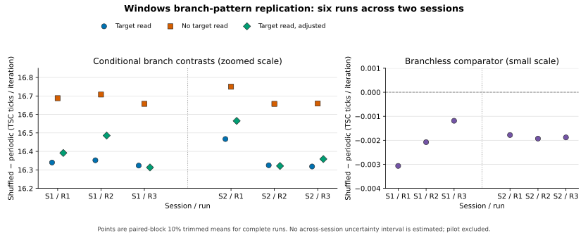

# Windows branch ablation: six-run, two-session replication

**Status:** six complete version 2 runs in two same-day sessions on one physical Windows host, following the [single-run pilot](../2026-10-30-windows-v2-pilot/README.md). This is a user-mode branch-pattern timing experiment. It does not measure a kernel boundary, count mispredictions, or identify a unique microarchitectural cause.

## Preserved evidence and protocol

The [manifest](manifest.json) lists all 14 supplied files: three matching trace/EXE pairs and one host snapshot per session. The [machine-readable summary](series-summary.json) retains individual contrasts and within-run intervals. The first run timestamps in the traces are `2026-10-30T13:16:02Z` through `13:16:20Z` (14:16 local time in Warsaw); the second are `15:19:54Z` through `15:20:13Z` (16:19 to 16:20 local time). The snapshots were captured at `13:15:25Z` and `15:19:44Z`, respectively. The archives supplied for this analysis contain exactly these six runs; an archive by itself cannot prove that no other runs took place.

Each run has a distinct recorded nonzero seed and 144 complete eight-condition blocks after eight warm-up blocks. Each condition measures 8,192 calls. The analyzer replays the seed to validate every randomized pattern and condition order, checks the complete sample count and checksum, and applies the same 10% trimmed estimator and eight-block-cycle bootstrap as in the pilot. Every executable SHA-256 equals the hash recorded in its paired trace. All six `.text` section hashes equal `7ecae6f5ee8c9114e750f30c9c196b1c0685d9f0f0f302fb8d752296baa0d469`, also matching the pilot. The full EXE hashes differ because compilation stamps differ. Disassembly confirms the same three branch/control sites and loop call sites as the pilot. A trace does not itself identify the Git revision of its source code.

Both host snapshots record Windows 11 Pro build 26200, AMD Ryzen 7 9800X3D, BIOS FA9, Balanced power plan, and a present hypervisor. Each trace records affinity to logical CPU 0, invariant TSC, and CPU signature `0x00b40f40`. Exact microcode, mitigation state, CPU frequency, concurrent workload, and SMT-sibling activity were not recorded. All six traces have a GCD of 47 TSC ticks across batch totals; the cause is not established.

## Run-level results

Values are 10% trimmed means of **paired blockwise** differences, in TSC ticks per 8,192-call loop iteration. `Branch`, `No-load branch`, and `Branchless` compare a fresh balanced shuffle against repeated `0011`. `Adjusted` subtracts the branchless difference from the loaded-branch difference *within each block* before trimming; it need not equal the difference of the separately trimmed columns. Timer positives count blocks in which the added-work control was slower. Each trace has its own within-run bootstrap interval, which must not be treated as an interval across sessions.

| Session / run start UTC | Seed | Branch | No-load branch | Branchless | Adjusted | Timer positives |
| --- | ---: | ---: | ---: | ---: | ---: | ---: |
| 1 / 13:16:02 | 3373702902 | +16.340 | +16.688 | −0.003066 | +16.391 | 139/144 |
| 1 / 13:16:12 | 254117976 | +16.352 | +16.708 | −0.002077 | +16.486 | 137/144 |
| 1 / 13:16:20 | 2397148980 | +16.323 | +16.657 | −0.001187 | +16.313 | 143/144 |
| 2 / 15:19:54 | 3069940628 | +16.467 | +16.750 | −0.001781 | +16.565 | 139/144 |
| 2 / 15:20:04 | 2578828063 | +16.325 | +16.657 | −0.001929 | +16.321 | 140/144 |
| 2 / 15:20:13 | 925131770 | +16.318 | +16.659 | −0.001879 | +16.359 | 142/144 |



The [figure source](plot_replication.py) draws the six run estimates on separate branch and branchless scales, without an across-session uncertainty bar. It requires Matplotlib and excludes the earlier pilot.

The run-level mean loaded-branch effect is +16.338 in session 1 and +16.370 in session 2; the no-load means are +16.684 and +16.689. The adjusted means are +16.397 and +16.415. These differences between two sessions are descriptive. With only two same-day sessions, there is no defensible session-level confidence interval or claim about generalization across days or hosts. The earlier pilot's distinct preselected seed and +16.280 loaded / +16.649 no-load estimates are reported separately, not treated as a seventh planned replication.

All six timer controls meet the pre-existing acceptance rule, which requires at least 95% positive blocks and a positive within-run cycle bootstrap lower bound. The weakest passed at 137/144 (95.14%), close to that threshold. The added-work timer difference ranges from +3,676 to +3,809 ticks per batch. The branchless point estimates are small, about 0.007% to 0.019% of the loaded-branch contrasts in absolute value, yet the within-run bootstrap intervals exclude zero for the first two runs. Thus the comparator is small at this scale, not demonstrated to be exactly zero or equivalent to zero.

The raw traces retain substantial isolated timing spikes. Across the six runs, blockwise adjusted contrasts include values from about −74.75 to +170.47 ticks per iteration; untrimmed block means are more sensitive to these spikes. The prespecified 10% trimmed adjusted estimates remain +16.313 to +16.565, while paired block medians range +16.277 to +16.328. An exploratory 20% trim yields +16.279 to +16.327. The positive contrast persists under these sensitivity summaries, but the point estimate's precision depends on the estimator and the observed noise. We did not remove any blocks.

## Interpretation

The shuffled-versus-periodic timing contrast recurs with six distinct seeds and in both measurement sessions. It is also present at a conditional branch that does not load the target byte inside its timed assembly function. A target-byte load **inside that function** is therefore not necessary for this effect in these binaries. The harness touches the target line before timing for every condition. Loaded and no-load branches occupy different addresses and execute different taken-path instructions, so their observed −0.354 to −0.249 ticks/iteration difference in *pattern effects* does not isolate a target-load cost.

The data are consistent with sensitivity to outcome order at conditional branches, but timing alone cannot count wrong predictions or establish predictor state, speculative leakage, or privilege-domain sharing. Session membership, common source, and host configuration limit independent replication. All six supplied runs are reported and pass the timer control; completeness beyond the supplied archives cannot be independently verified.

## Reproduction

From the repository root, run the complete series check and descriptive summary:

```bash
python3 scripts/summarize_branch_batch_series.py results/2026-10-30-windows-v2-replication/manifest.json
```

Add `--output results/2026-10-30-windows-v2-replication/series-summary.json` to regenerate the archived JSON summary.

For one run, independently replay and summarize its raw trace:

```bash
python3 scripts/analyze_branch_batch.py results/2026-10-30-windows-v2-replication/session-1/branch-batch-windows-20261030T131602Z.log --strict --json
```

With Matplotlib installed, regenerate the archived figure using `python3 results/2026-10-30-windows-v2-replication/plot_replication.py`.

The series script checks the listed trace/EXE pairings, unique seeds, host metadata, and stable executable code and reports all runs, including any with failed timer controls. Its across-run summaries are descriptive, not a substitute for more independent measurement sessions or a direct hardware event measurement.
