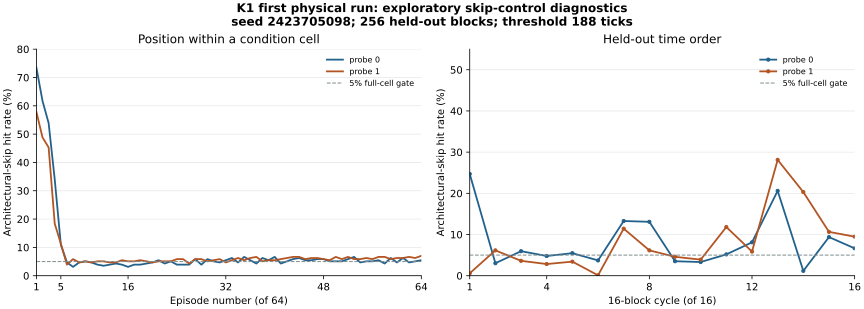

# K1 conditional target-data receiver: first physical Windows pilot

**Observed:** the Windows executable built and completed all 512 blocks. Its
receiver threshold and positive controls worked, but the held-out
architectural-skip control failed for both target directions. Per the
[frozen K1 protocol](../../CONDITIONAL_RECEIVER_V1.md), the candidate
association is **inconclusive**, not positive or a validated null. The task's
exit code 1 was the intended strict-analysis gate, not an assembler failure.

## Original evidence and replay

Retain the original `conditional-receiver-windows-20261101T172116138Z.zip`
unchanged, SHA-256
`4d5ce4aa5a4c13460abecfec4563e74a400203d452c134072697bfac6acf506f`.
Its ZIP CRC and seven manifest member hashes pass. Its eleven source hashes
match clean Git commit `b714b61ea11cdb54a610557dcd7c138b06937723`.
The recorded nonzero seed is `2423705098`, and the raw trace replays the
preselected schedule, sample order, checksum and architectural totals under
the frozen analyzer. The executable SHA-256 is
`9ac4d2759994a3bb173c8c8f8709297d9ada9a620786dbf09c33ff8abe105fab`;
the PE `.text` SHA-256 independently matches the archived provenance,
`9e03d7d9d24d7439a9e1334f17bbd7cafe9b40e31094e15a6f2b0928f83ce809`.
The analyzer replay agrees with the archived JSON and strict output. These
are internal consistency checks, not independent attestation of the host.

The recorded host is AuthenticAMD signature `0x00b40f40`, Windows build
`26200`, hypervisor bit 1, process pinned to logical CPU 0. The trace reports
512 complete blocks, 64 repeated episodes per condition, and a threshold of
188 TSC ticks calibrated separately for p0 and p1 on the first half.
The second half supplies all values below. Each rate has 16,384 individual
reloads per cell; these are dependent within-run observations, not 16,384
independent experiments.

| Held-out outcome | Probe p0, opposite target 1 | Probe p1, opposite target 0 |
| --- | ---: | ---: |
| Hot control | 99.82% | 99.92% |
| Cold control | 0.006% | 0.000% |
| Architectural load | 99.88% | 99.87% |
| Architectural skip | **8.25% (fails ≤5%)** | **8.06% (fails ≤5%)** |
| No-probe controls | ≤0.006% each | ≤0.006% each |
| Adjusted mismatch minus match | +0.75 percentage points | +2.66 percentage points |
| Within-run 95% cycle-bootstrap interval | [−1.97,+3.05] points | [−1.82,+7.47] points |

Both adjusted intervals include zero. The p0 primary also falls short of the
prespecified interval-above-+5-point candidate rule. The p1 mirror is
secondary and not multiplicity-adjusted. The failed skip controls prevent a
claim of either an eligible positive or an eligible null from K1.

## Linked instruction audit

The archived PE disassembly corresponds to the logged ASLR-adjusted branch
address. The assembly branch starts at RVA `0x2030`: `movzx` reads the
condition through `rcx`, `test`/`je` selects target zero at RVA `0x20C2`,
or falls through to target one at `0x203D`. The zero body loads `[rdx]`;
the one body loads `[r8]`; each returns. They are separated by 128 NOPs.
Logged condition, target-zero and target-one data start on separate 4 KiB
pages at RVAs `0x25000`, `0x26000` and `0x27000` respectively. The one
direct call to this assembly site is in the shared invocation wrapper.

The optimized collector flushes both targets, then the condition, and
executes `MFENCE` before the probe. The candidate and skip paths call the
shared assembly site, then time the opposite data line using fenced `RDTSC`.
The branch returns the architecturally expected target value for all recorded
episodes. This static audit supports the intended architectural path, but
cannot distinguish a wrong-path load from prefetch, predictor context or
harness behavior. The target-one load spans the 64-byte code boundary at
RVA `0x2040`; the two target bodies have different fetch layouts.

After the flush, the optimized C collector also has a branch into the HOT
control's explicit opposite-line touch. Candidate/skip paths do not take
this branch architecturally. Speculative execution of that harness branch
is one possible contaminant, not an established cause in this trace.

## Exploratory position and time diagnostics

These slices were selected **after** inspecting K1 and do not change its
predeclared endpoint or gate. In the held-out half, the first five of each
64-episode `arch_skip` cell contain 599/1,280 (46.80%) hits for p0 and
465/1,280 (36.33%) for p1. The remaining 59 positions contain 752/15,104
(4.98%) and 856/15,104 (5.67%) hits. Thus 44% and 35% of all skip hits
occur in just five of 64 positions. Candidate cells also show an early spike;
no-probe and cold controls remain near zero. The first half of K1 had higher
skip rates than the held-out half, so even a fixed late-episode background is
not established by this run.

No first-episode observations may be discarded retrospectively to force the
original skip gate below 5%. The figure below, generated by
[`plot_episode_rates.py`](plot_episode_rates.py) from the original ZIP,
is descriptive, with no independent-replication uncertainty interval.

## Interpretation and next diagnostic

The empty no-probe result and the probe-associated skip hits show that the
extra heat arises in a context requiring a probe, but they do not identify
which instruction or mechanism filled the line. The temporal pattern makes
condition-entry carryover, changing predictor context, harness speculation,
prefetch and changing host state competing explanations. Hypervisor presence
and asymmetric code fetch layout add limits. K1 was a same-process receiver
pilot; it did not test Fractal OS, a security-domain crossing, or the paper's
Apple M1 mechanism.

A new, separately frozen K2 study should compare the same conditions in
64-episode grouped cells against balanced interleaving, with each episode's
index and order recorded. Declare the early-versus-late skip contrast as a
K2 outcome before collecting K2 data, with hot/cold, architectural-load and
no-probe checks. Include a structurally separated HOT calibration path or a
separate branchless/retire-only comparator to test the harness explanation.
Audit the new linked executable and retain every K2 run, including failed
controls. K2 is proposed here, not implemented or measured in this report.
