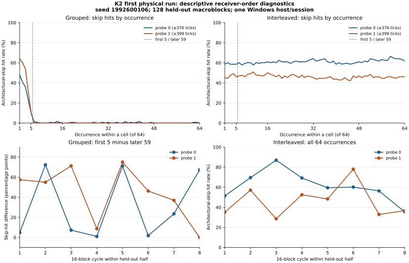

# K2 receiver order: first physical Windows pilot

**Observed:** the new grouped/interleaved conditional-receiver executable built
and completed its first physical run. All 20 prespecified apparatus gates
passed. The frozen primary grouped probe-0 architectural-skip entry contrast
was **+31.15 percentage points**, with a 95% within-run cycle-bootstrap
interval of **[+10.99,+53.65]** points. This clears K2's predeclared
interval-above-+10-point rule for a *condition-entry association in this run*.
Interleaving instead produced frequent opposite-line cache hits throughout
the cell. Neither schedule yielded a convincing trained-target contrast.
This is an engineering pilot, not a replicated branch-predictor or transient-
execution finding.

## Evidence, replay and host

Retain the original `receiver-order-windows-20261101T183141068Z.zip`
unchanged, SHA-256
`7d464c02af3e13e0051ed771756bcf8c220143d0a40226e85d9e598b50260cb5`.
ZIP CRCs and all seven member hashes in the archived manifest pass. The
12 source hashes in its build provenance match clean Git commit
`e745b2a6a6f146c0028176070bddee0062f849af`, including the
[pre-physical K2 protocol](../../RECEIVER_ORDER_K2.md) and analyzer.
The original raw trace passes the analyzer's complete-block, episode-order,
schedule-hash, architectural-return and sample-count checks; a fresh replay
agrees with the archived analysis. The strict analyzer exited 0. The
executable SHA-256 is
`61bc5fad406462a640bc50e3dfc0647d687c70253de128083fdf7d1b6cd3b76c`;
its PE `.text` hash is
`54d9af2ea69a7acff3ba2a57e1872550f15b2a3455b1d5046be49dd08fda12c8`.
The archived build sidecar marks instruction audit *pending*: the separate
read-only review below does not rewrite that historical sidecar.

The trace reports seed `1992600106`, AuthenticAMD signature `0x00b40f40`,
Windows build `26200`, hypervisor bit 1 and affinity to logical CPU 0. There
were 16 warm-up and 256 recorded macroblocks, each containing all 16
conditions under both schedules, with 64 episodes per condition. The first
128 recorded blocks supplied pooled-across-mode thresholds of **376 ticks
for probe 0** and **399 for probe 1**. The last 128 blocks supplied every
outcome below. These many episodes are dependent observations in one run,
not independent host replications.

## Frozen controls and outcomes

All 20 held-out gates passed: for each mode and probe direction, HOT was
99.69–99.80%, COLD 0%, architectural LOAD 99.82–99.87%, and each of the
two train-matched NO-PROBE controls at most 0.024%. K2 deliberately treats
architectural SKIP as an **outcome**, not as a gate. Thus a high skip rate
does not invalidate this particular diagnostic, and a passed diagnostic
does not repair K1's failed skip gates.

| Held-out architectural-skip result | Probe 0 | Probe 1 |
| --- | ---: | ---: |
| Grouped, first 5 of 64 episodes | 31.41% | 43.91% |
| Grouped, remaining 59 episodes | 0.25% | 0.07% |
| Grouped early minus late, within-block mean | **+31.15 pp** | +43.84 pp |
| 95% within-run 16-block-cycle bootstrap | **[+10.99,+53.65] pp** | [+25.25,+60.65] pp |
| Grouped, all 64 episodes | 2.69% | 3.49% |
| Interleaved, all 64 episodes | **61.06%** | **46.15%** |
| Interleaved early minus late | −2.34 pp | +0.44 pp |
| Grouped minus interleaved early-minus-late contrast | +33.49 pp | +43.40 pp |

Only the grouped probe-0 early-minus-late row is the frozen primary test.
The p1 mirror and schedule interaction are prespecified secondary descriptions;
their intervals are not multiplicity adjusted. The first-half grouped probe-0
entry contrast was approximately +47.5 points, versus +31.15 in the held-out
half. Within the eight held-out 16-block cycles, the probe-0 grouped entry
contrast varied from +1.04 to +72.29 points. Interleaved full-cell probe-0
skip rates varied from 35.45% to 86.91% by cycle. This heterogeneity and
the eight-cycle bootstrap limit extrapolation beyond the run.

The candidate trained-label mismatch-minus-match hit-rate comparisons do
not establish a target-specific receiver:

| Candidate mismatch minus match | Probe 0, 95% within-run interval | Probe 1, 95% within-run interval |
| --- | ---: | ---: |
| Grouped | +0.94 pp [−1.10,+2.81] | −0.66 pp [−1.90,+0.59] |
| Interleaved | −0.46 pp [−17.61,+16.11] | −3.27 pp [−18.64,+10.53] |

Every candidate interval includes zero. The high interleaved skip hit rate
is an association with this probe and scheduling context, not evidence of a
training-label-specific target. The timing distributions are bimodal:
interleaved skip hits largely occupy the same 47/94-tick values as HOT,
while cold samples cluster around 423/470/517 ticks. The interleaved effect
is therefore not explained by many borderline values around the threshold.
An exploratory fixed 188-tick reclassification leaves the grouped probe-0
early/late rates about 31.41%/0.24% and interleaved full-cell rate about
61.05%; it does not replace the frozen thresholds or primary analysis.

## Linked instruction review

The archived disassembly's SHA-256 is
`360460854aadff93d7fa69e72fdb800d1841d5255a53ed2ece675823aac52ca9`.
The logged branch address `0x7ff64b922680` maps to PE RVA `0x2680`.
This single shared MASM branch reads the condition, tests it, and jumps to
target zero at RVA `0x2712`, which loads `[rdx]`; the fallthrough target
one at RVA `0x268D` loads `[r8]`. They return distinct architectural
values. The target data and condition occupy separate 4 KiB pages at RVAs
`0x27000`, `0x28000` and `0x26000`, respectively.

The optimized episode dispatch calls a branch helper for candidate and
architectural-skip paths, a distinct noinline HOT helper for positive
controls, and a no-probe helper for COLD/NO-PROBE. Preparation flushes
both target lines and the condition line, then executes `MFENCE`. Only
the HOT helper explicitly touches the measured target after that flush;
the candidate/skip helper calls the shared branch site and then a fenced
`LFENCE/RDTSC` reload. The no-probe helper reloads without invoking the
branch. There is one direct call site to the shared assembly branch. This
static review supports the logged instruction topology and absence of an
architectural HOT touch on candidate/skip paths. It cannot prove that no
other cache or speculative path heated the line.

The target-one body shares a 64-byte code line with the branch, whereas
target zero is on another line. This fetch-layout asymmetry, global
history, condition ordering, prefetch and host behavior remain possible
sources of direction and schedule differences. The separate HOT path and
other K2 layout changes also prevent a causal K1-versus-K2 statement about
what caused K1's skip failure.

## Interpretation and next measurement

K2 reproduces a large **grouped condition-entry cache-hit pattern** under
its new harness, and shows an even larger but sustained interleaved skip
rate. The frozen classification is satisfied for this one run. Its
positive controls and code review make it a useful apparatus and scheduling
diagnostic; they do not show that a trained branch target was recovered, or
identify misprediction, transient target execution, a specific cache level
or a Fractal cross-domain mechanism. K1 remains inconclusive under its
own frozen rules. No M1, Fractal OS, kernel or ASID comparison was run.

Run the **same K2 source and task** in another independent session with
its automatically preselected new seed; archive the entire outcome, even
if it fails or changes sign. A same-day second session is useful for
short-term stability; another date would test day-to-day robustness.
Analyze complete runs as the replication units. An eventual mechanistic
claim would also need an intervention separating scheduling and harness
activity from the branch's transient path, with a validated target-specific
receiver. The figure below is descriptive and reproduced from the original
ZIP by the accompanying plot script.

