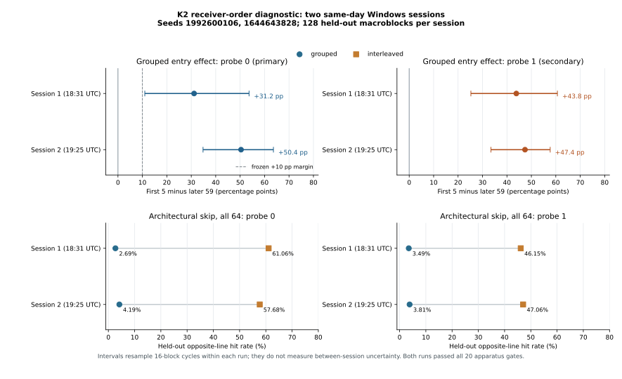

# K2 receiver order: two same-day Windows runs

**Outcome:** both supplied K2 runs completed, passed all 20 prespecified
apparatus gates, and met the frozen grouped probe-0 condition-entry rule.
The primary contrasts were **+31.15** and **+50.37 percentage points**.
Their within-run 95% cycle-bootstrap intervals were respectively
**[+10.99,+53.65]** and **[+34.81,+63.63]** points. The second run used
a new seed and the same linked machine-code bytes. This is a short-term,
same-host recurrence of *schedule-sensitive cache heat*, not evidence that
the trained target was recovered or that transient execution caused it.

## Original evidence and reproducibility

Keep both original evidence ZIPs unchanged. The [first-run audit](../2026-11-01-windows-receiver-order-pilot/README.md)
records the initial physical result and linked instruction review. The
second run was launched roughly 53 minutes 25 seconds later, on the same
UTC date and logical CPU. The two supplied runs are the complete series
analyzed here; each complete run, not its many episodes, is one repetition.

| Evidence | First run | Second run |
| --- | --- | --- |
| ZIP | `receiver-order-windows-20261101T183141068Z.zip` | `receiver-order-windows-20261101T192505058Z.zip` |
| ZIP SHA-256 | `7d464c02af3e13e0051ed771756bcf8c220143d0a40226e85d9e598b50260cb5` | `46403c95f5c3754ec41dc729d514ee06ed050950dfe6791f1360ebfe23acb96c` |
| Recorded run start UTC | `20261101T183145Z` | `20261101T192510Z` |
| Seed | `1992600106` | `1644643828` |
| Clean Git revision at build | `e745b2a6a6f146c0028176070bddee0062f849af` | `df88c60ae47b6ea662c5758746ea4c74248d4e0c` |
| Whole PE SHA-256 | `61bc5fad406462a640bc50e3dfc0647d687c70253de128083fdf7d1b6cd3b76c` | `ccd64957591ccf0d4cc87b99f4632f8ecadef8fe58be2dc47b41d943d76cd2eb` |
| PE `.text` SHA-256 | `54d9af2ea69a7acff3ba2a57e1872550f15b2a3455b1d5046be49dd08fda12c8` | Same |
| First-half pooled thresholds | p0 376, p1 399 ticks | p0 352, p1 399 ticks |

For each archive, ZIP CRCs and all seven manifest member hashes pass.
The 12 recorded source hashes match the repository at the recorded clean
commit and are identical across runs. The second raw trace replays every
computed field of its archived analysis, including order, architectural
returns and checksums; its strict analyzer exited 0. Both runs report an
AuthenticAMD CPU with signature `0x00b40f40`, Windows build `26200`,
hypervisor bit 1 and process affinity to logical CPU 0. Both have 16
warm-up and 256 recorded macroblocks, with the first 128 used only for
threshold calibration and the final 128 for outcome analysis. No episodes
or cycles were removed after viewing their values.

The full executable hashes differ, but byte comparison found **only four
different bytes**, in PE and debug-directory timestamps. The 94,720 raw
`.text` bytes, six-section layout and branch/target/data relative
addresses are identical. The [first-run linked-code review](../2026-11-01-windows-receiver-order-pilot/README.md#linked-instruction-review)
therefore applies to the second executable: one shared conditional branch,
separate target data pages, flush/fence/reload, and a distinct explicit HOT
path. The archive still marks its instruction audit pending; this report
records the separate read-only comparison. Identical instructions do not
ensure identical cache, predictor or operating-system state.

## Prespecified outcomes

The protocol calibrates HOT/COLD across scheduling modes in the first half
and checks 20 mode-specific apparatus gates in the held-out half. All 20
passed **in each run**. Across both runs, held-out HOT was at least 99.69%,
COLD 0%, architectural LOAD at least 99.82%, and each NO-PROBE control at
most 0.024%. Architectural SKIP is a K2 outcome, deliberately not an
apparatus gate. K1's separate failed SKIP gate is unchanged.

| Held-out result | First run | Second run |
| --- | ---: | ---: |
| Grouped p0 SKIP, first 5 / later 59 | 31.41% / 0.25% | 50.63% / 0.25% |
| **Frozen primary, grouped p0 early minus late** | **+31.15 pp [10.99,53.65]** | **+50.37 pp [34.81,63.63]** |
| Grouped p1 early minus late, secondary | +43.84 pp [25.25,60.65] | +47.39 pp [33.46,57.71] |
| Grouped p0/p1 SKIP, all 64 | 2.69% / 3.49% | 4.19% / 3.81% |
| Interleaved p0/p1 SKIP, all 64 | 61.06% / 46.15% | 57.68% / 47.06% |
| Interleaved p0/p1 early minus late | −2.34 / +0.44 pp | −1.89 / +1.84 pp |
| Grouped minus interleaved p0 entry effect | +33.49 pp [11.68,57.54] | +52.26 pp [34.38,67.01] |

All bracketed intervals in this table are **within-run** 95% bootstraps of
complete 16-block cycles, not confidence intervals for the difference
between sessions. The primary rule required the entire first interval to
exceed +10 pp when apparatus gates passed. Both runs meet it, although the
first run's lower limit is only about one point above the margin. The p1
and mode-interaction rows are prespecified secondary descriptions without
multiplicity correction.

The eight held-out 16-block cycles varied substantially. Grouped p0 entry
contrasts ranged from +1.04 to +72.29 pp in the first run, and +4.79 to
+77.18 pp in the second. Interleaved p0 full-cell SKIP rates ranged from
35.45% to 86.91% and from 26.56% to 92.38%, respectively. The first-half
grouped p0 entry contrast was +47.46 pp in run one and +40.26 pp in run
two, versus the held-out +31.15 and +50.37 pp. These changes warn against
using episode count as a measure of between-session precision.

The candidate trained-label comparison remains unresolved in **both** runs:

| Mismatch minus match, within-run 95% interval | First run | Second run |
| --- | ---: | ---: |
| Grouped p0 | +0.94 pp [−1.10,+2.81] | −0.31 pp [−1.93,+1.62] |
| Grouped p1 | −0.66 pp [−1.90,+0.59] | +0.70 pp [−0.83,+2.67] |
| Interleaved p0 | −0.46 pp [−17.61,+16.11] | +7.56 pp [−13.62,+28.91] |
| Interleaved p1 | −3.27 pp [−18.64,+10.53] | +2.99 pp [−17.09,+24.26] |

Every interval includes zero; neither run identifies the trained target.
The interleaved SKIP line often reads HOT despite no-probe controls near
zero. Its hit pattern is bimodal rather than a threshold-edge artifact.
An exploratory 188-tick cutoff leaves the strong entry and interleaved
patterns essentially intact, but it does not replace either run's frozen
calibration or justify a mechanistic classification.

The accompanying `plot_two_runs.py` regenerates the descriptive figure
directly from the two original ZIPs. It does not pool episodes or compute
an across-session interval.

## Inference and next step

The two separate same-day runs support **short-term repeatability on this
one Windows host** of K2's condition-entry and scheduling associations.
They do not establish day-to-day stability, host-to-host transportability,
training-label-specific target recovery, branch misprediction, transient
execution or any cross-domain Fractal result. K2 was designed after K1's
exploratory early spike; its successful diagnostic must not be treated as
an independent confirmation of the paper's Apple M1 mechanism.

Preserve this two-run series. An unchanged-code run on another date would
assess day-to-day robustness, with a new seed and every failed-control or
null attempt retained. A *separately frozen* intervention should then
distinguish branch-path activity from condition ordering, adjacent
training/context effects, prefetch and host scheduling. Its primary
target-label comparison needs a validated receiver before a transient-
execution interpretation is considered.
