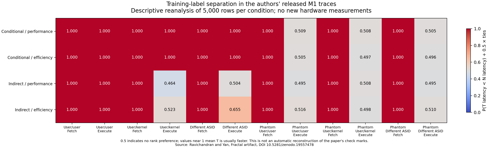
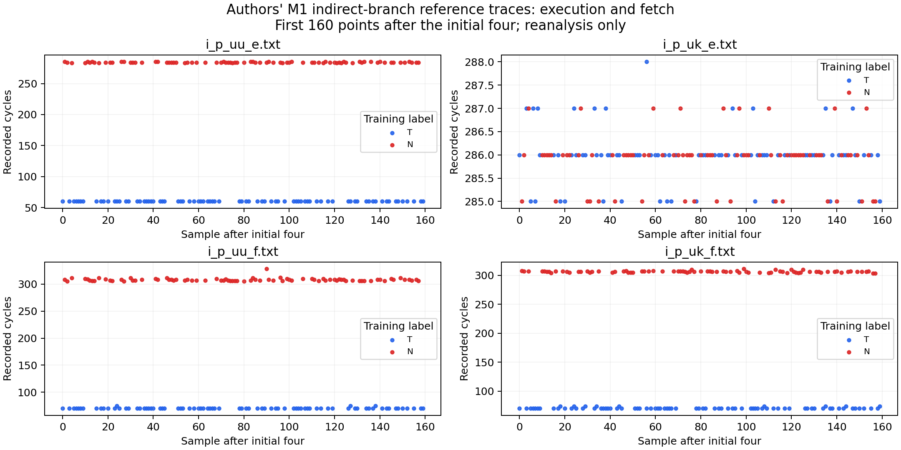

# Reanalysis of the authors' released Fractal M1 data

This directory contains an independent descriptive analysis of the authors' published M1 traces. It contains no new hardware measurements. It does not establish the Fractal findings on AMD, Windows, or this workstation.

The useful result is a reproducible reference: all 48 released conditions can be inspected and summarized on an ordinary Windows or Linux computer, without an Apple machine. It also makes the measurement distinction that a future x86 experiment must preserve explicit.

## Source and attribution

Joseph Ravichandran and Mengjia Yan, *Fractal: An Operating System Designed for Microarchitecture Reverse Engineering*, IEEE Symposium on Security and Privacy, 2026.

- [Paper](https://people.csail.mit.edu/mengjia/data/2026.SP.fractal.pdf)
- [Authors' project](https://fractal-os.com/)
- [Artifact concept DOI](https://doi.org/10.5281/zenodo.19556693)
- [Pinned artifact version DOI](https://doi.org/10.5281/zenodo.19557478), published April 13, 2026
- [Pinned ZIP download](https://zenodo.org/api/records/19557478/files/fractal.zip/content)

The source ZIP is 887,119 bytes, with SHA-256 `8ee05fcccc9c80769c812bdd9f698226b48155aee2dbb6f491798da668182ac2`. Its top-level directory is `fractal-artifact-evaluation-sp26-e2cbabefe17a736be5b162f1e363eab618fc9796/`. Inputs are the 48 files under `precollected_data/`. Per-input SHA-256 values appear in `authors-data-summary.json`.

The Zenodo record advertises CC BY 4.0, while the separately supplied `metadata.toml` points to GPL 3.0. The ZIP contains no `LICENSE` or `COPYING` file. The standalone kernel repository's MIT license does not resolve that discrepancy for the separate artifact. This directory does not vendor the authors' source code or raw traces. Source attribution and this discrepancy should be retained when redistributing generated analysis or considering upstream code reuse.

## Reproduce

The analyzer uses Python's standard library for validation, JSON, and CSV. Python 3.10 or later is suitable. Figures require Matplotlib; the recorded run used Python 3.12.14, NumPy 2.3.5, and Matplotlib 3.10.8. LaTeX is not required. Run from the repository root.

Windows PowerShell:

```powershell
py -3 -m pip install matplotlib==3.10.8
py -3 scripts/reanalyze_fractal_authors_data.py --archive out/fractal-authors-19557478.zip --download --output out/fractal-author-data-reanalysis --plots
```

Linux:

```sh
python3 -m pip install matplotlib==3.10.8
python3 scripts/reanalyze_fractal_authors_data.py --archive out/fractal-authors-19557478.zip --download --output out/fractal-author-data-reanalysis --plots
```

`--download` retrieves only the pinned archive when the local archive is absent. The SHA-256 must match before any trace is analyzed. To work offline, supply that archive and omit `--download`. Omit `--plots` to produce the machine-readable summaries without installing Matplotlib. The program reads data from the ZIP, uses `ast.literal_eval` for the literal data list, and never executes the artifact's code, installation script, or hardware controller.

## Analysis and observed results

Each of the 48 traces contains 5,004 latency rows, for 240,192 published rows in total. The JSON reports both all rows and rows after the first four. The CSV and matrix use the remaining 5,000 rows, containing 2,419 T labels and 2,581 N labels in every condition. All 48 logs use the same training-label sequence. These logs are one published trace per condition, not 48 independent replications of one condition.

The authors' latency figures and Table 1 visualization use the first 160 points after removing the initial four (`[4:164]`). Their histogram script uses all 5,004 rows. Our descriptive matrix uses all 5,000 rows after the initial four, and therefore is a different summary from their displayed 160-point traces.

The rank statistic is the fraction of all T/N sample pairs for which T has lower recorded latency, counting equal latencies as half a pair: `P(T < N) + 0.5 P(T = N)`. Values near 1 describe strong separation in the expected direction. A value near 0.5 describes little rank preference in these samples. It is not a null-hypothesis test, proof of absence, confidence interval, cache-hit classification, or automatic reconstruction of the paper's Table 1 check marks. No positive-result cutoff was introduced.

Selected performance-core indirect-branch observations, after the initial four:

| Published condition | T median cycles | N median cycles | Rank statistic |
| --- | ---: | ---: | ---: |
| User/user, execute, same ASID | 60 | 284 | 1.000000 |
| User/kernel, execute | 286 | 286 | 0.463993 |
| User/user, fetch, same ASID | 70 | 307 | 1.000000 |
| User/kernel, fetch | 70 | 306 | 1.000000 |
| User/user, execute, different ASID | 286 | 286 | 0.503948 |

These released traces show the paper's central measurement distinction particularly clearly: the user/kernel indirect-branch fetch sensor separates the training labels, while its execution sensor does not show the same large low/high latency separation. Conditional-branch user/kernel execution also separates in this dataset. Phantom fetch conditions separate while their execution distributions overlap substantially.

Do not interpret every execution condition with a small median difference as identical or signal-free. The efficiency-core indirect, different-ASID execution trace has medians of 747 and 748 cycles and a rank statistic of **0.655242**. That one-cycle shift is visible to a rank summary, although it is not the large cache-hot/cache-cold signature shown by the separated reference traces. The complete per-condition numbers are retained instead of replacing such cases with a binary verdict.

The original artifact's `SP_RESULTS.md` states that Figure 8 was corrected after a bug fix relative to the submitted paper. This analysis is pinned to the April 2026 artifact version and does not claim every result is identical to every earlier manuscript version.





## Validation and limits

The recorded run verified the source archive hash, all 48 trace hashes, experiment markers, filenames against experiment headers, allowed labels, positive integer latencies, and the expected 5,004 rows. A separate frequency-count calculation matched the rank statistic for all 48 conditions. `validation.json` records rejection of a one-byte archive change, missing and duplicate experiment markers, mismatched privilege headers, an unknown filename, a missing sample, and an invalid label.

The authors' three unmodified plotting programs were also tried privately. They failed because this environment lacks LaTeX's `type1ec.sty`. Private copies then produced Figures 5, 6, 7, 8, and the Table 1 latency grid after changing only `text.usetex: True` to `False` and `font.serif: Computer Modern` to `DejaVu Serif` in the style file. Those were rendering compatibility checks, not pixel-identical reproductions. The private copies and their generated PDFs are not included here. The public figures above come from the independent analyzer.

This work checks the published data and provides a portable analysis reference. Independent support for the same mechanism on the user's AMD host still requires new, controlled hardware experiments. The artifact does not provide an x86 version of its M1 experiment backend: it uses ARM instruction generation, Apple performance-counter registers, M1 cache geometry, and m1n1-based hardware control. Booting the x86 Fractal kernel alone would not run these M1 experiments.

## Files

- `authors-data-summary.json`: all-row and post-initial-four statistics, all source trace hashes, provenance, and scope.
- `authors-data-summary.csv`: post-initial-four statistics in a flat table.
- `authors-m1-descriptive-matrix.{png,pdf,svg}`: descriptive summaries of all 48 conditions.
- `authors-m1-reference-traces.{png,pdf,svg}`: the four indirect performance-core reference traces.
- `validation.json`: recorded checks and rejected invalid inputs.
- `provenance.json`: exact recorded command, source identity, environment, output hashes, and private rendering-check status.
